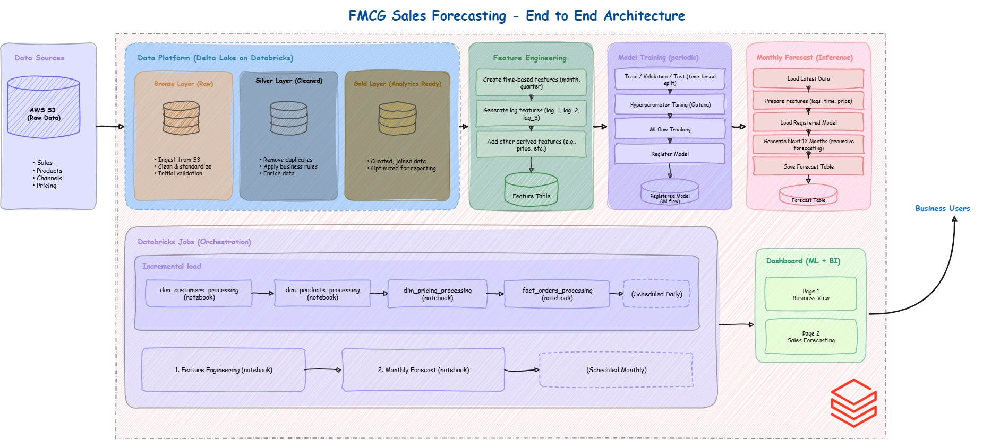

# FMCG Sales Forecasting Data Platform 
An end-to-end **data engineering + machine learning project built with
Databricks** for processing FMCG sales data, implementing a
Bronze/Silver/Gold architecture, orchestrating ETL pipelines, and
generating monthly sales forecasts.

------------------------------------------------------------------------

## 1. Project Overview

The platform ingests raw FMCG CSV files from **Amazon S3**, processes
them through a medallion-style architecture, creates business-ready Gold
tables, and uses historical sales data to forecast future demand.

### Main flow



## 2. Business Goal

The project has two main goals:

1.  Build a reliable data platform that transforms raw FMCG data into useful insights.
2.  Use historical sales behavior to estimate future demand and expose
the results through a dashboard.

The forecasting component predicts **monthly sold quantity** at the
product/channel level.

------------------------------------------------------------------------

## 3. Technology Stack

| Area                   | Technology                              |
| ---------------------- | --------------------------------------- |
| Cloud storage          | Amazon S3                               |
| Platform               | Databricks                              |
| Processing             | PySpark                  |
| Storage format         | Delta Lake                              |
| Governance             | Unity Catalog                           |
| Data architecture      | Bronze / Silver / Gold                  |
| Workflow orchestration | Databricks Jobs                         |
| ML framework           | LightGBM + Optuna                       |
| Experiment tracking    | MLflow                                  |
| Forecasting approach   | Supervised regression with lag features |
| Analytics              | Databricks SQL / Dashboard              |
| Source format          | CSV                                     |


## 4. Data Architecture

The platform follows a **medallion architecture**.

### Bronze

Bronze contains data close to its original source form.

Typical metadata added during ingestion includes:

-   `load_date`
-   `file_name`
-   `file_size`

These fields help with lineage and traceability.

The goal of Bronze is to extract data from S3 to process it.

### Silver

Silver contains cleaned and standardized data.

Examples of transformations performed in the project include:

-   data type corrections
-   date normalization
-   handling missing values
-   correcting known data-quality issues
-   standardizing columns.

### Gold

Gold contains business-ready datasets designed for analytics and ML.

The project contains dimensional/fact tables following a star schema:

-   `dim_date`
-   `dim_customers`
-   `dim_products`
-   `dim_gross_price`
-   `fact_orders`

A denormalized analytical view combines the relevant dimensions and
measures for dashboarding.


## 5. Data Engineering Pipeline

The ETL pipeline follows:

``` text
S3 -> Bronze -> Silver -> Gold
```

The pipeline is orchestrated using **Databricks Jobs**.

## 6. Delta Lake

Delta provides capabilities such as reliable table storage and support
for operations such as `MERGE`.

The project also uses Change Data Feed where appropriate.

This provides a foundation for tracking row-level changes and supporting
incremental processing patterns.


## 7. Incremental Loading

The project uses an upsert (update + insert) pattern for tables that need to support
future incremental loads.

This allows the pipeline to process new or changed records without
simply rebuilding the entire table every time.

------------------------------------------------------------------------

## 8. Data Quality & Standardization

Several data-quality problems were handled during transformation.

Examples include:

### Missing cities

Customer-to-city mappings were used to correct missing values
rather than accidentally replacing the wrong column.

### Date formats

Input dates appeared in multiple formats and were unified into one format, for example:

``` text
2025/07/01
01/08/2025
2025-09-01
01-09-2025
```


### Identifier validation

String pattern validation was used to identify invalid product IDs and
other malformed values.

### Text cleaning

Regular expressions were used for case-insensitive matching and typo
correction.


## 9. Gold Data Model

The data model uses gold fact and dimension tables.

A denormalized view was created for dashboarding to make querying easy.

## 10. Forecasting

The ML component forecasts monthly `sold_quantity`.

The forecasting dataset is aggregated at:

``` text
product_code + channel + month
```

The model uses historical sales behavior to learn patterns.

### Features used by the best model

#### Lag features

``` text
lag_1
lag_2
lag_3
```

These represent:

``` text
lag_1 = previous month sales
lag_2 = sales two months ago
lag_3 = sales three months ago
```

#### Calendar features

``` text
month
quarter
```

These allow the model to learn recurring seasonal patterns.

#### Business feature

``` text
price_inr
```

Price is included because demand can be related to price.

#### Categorical features

``` text
product_code
channel
```

LightGBM handles these categorical variables directly.

------------------------------------------------------------------------

## 11. Why Lag Features?

A normal regression model has no sense of time. It only sees a
row of numbers and doesn't know that one row happened before another.
Lag features fix this by explicitly feeding the model what happened in
previous months (`lag_1`, `lag_2`, `lag_3`), so it can learn from recent
trends instead of treating every row as unrelated.

## 12. Baseline Model

Before trusting a complex model, a simple baseline was built to
prove that the ML model actually adds value over a naive forecasting
rule:

``` text
prediction = previous month's sales
```

The baseline achieved approximately:

``` text
TEST MAPE ≈ 43.65%
```


------------------------------------------------------------------------

## 13. Machine Learning Model

The model is a **LightGBM regression model**.

Hyperparameters were tuned with **Optuna** to find the best configuration
before training the final model.

Best feature configuration:

``` python
feature_cols = [
    "lag_1",
    "lag_2",
    "lag_3",
    "month",
    "quarter",
    "price_inr"
]

categorical_cols = [
    "product_code",
    "channel"
]
```

The model was evaluated using a time-based train/test split rather than
a random split.

This is important for forecasting because future observations must not
be used to train the model before evaluating it.

------------------------------------------------------------------------

## 14. Model Evaluation

The project uses:

### MAPE

Mean Absolute Percentage Error.

It measures the average relative prediction error.

### MAE

Mean Absolute Error.

It measures the average absolute difference between predicted and actual
sales.

The first LightGBM model achieved:

``` text
Model TEST MAPE:  32.51%
Baseline MAPE:  43.65%
```

A later validation evaluation was also performed during model
development.

The important principle behind the whole process is simple: train a
model, compare it against the baseline, validate it on future/unseen
periods, and only keep it if it provides a real improvement.

------------------------------------------------------------------------

## 15. MLflow

MLflow is used to track experiments and models.

Each training run can record:

-   hyperparameters
-   metrics
-   baseline performance
-   model versions

The production forecasting job loads the registered model instead of
retraining it every month.

------------------------------------------------------------------------

## 16. Production Forecasting Flow

Forecasting in production is kept separate from training. Each month,
the pipeline pulls the latest Gold data, rebuilds the same lag and
calendar features used during training, loads the registered model from
MLflow, and generates predictions for the next 12 months. The results
are written to a forecast table that feeds the dashboard directly.

------------------------------------------------------------------------

## 17. Monitoring & Alerting

Since the pipeline runs on a schedule without manual supervision,
alerting was added so failures don't go unnoticed. If the ETL job or
the forecasting job fails, an alert is triggered so it can be
investigated and fixed before it affects the dashboard.

------------------------------------------------------------------------


## 18. Dashboard

Two dashboard pages were built:

1. Sales insights
2. Sales forecast

PDF exports of both dashboards are available in the `/dashboards` folder.

------------------------------------------------------------------------